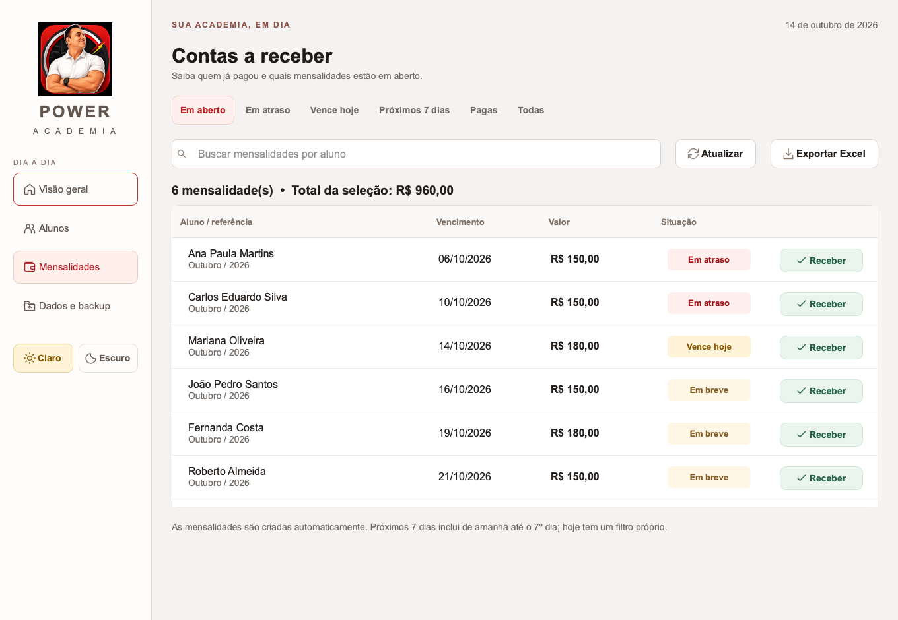
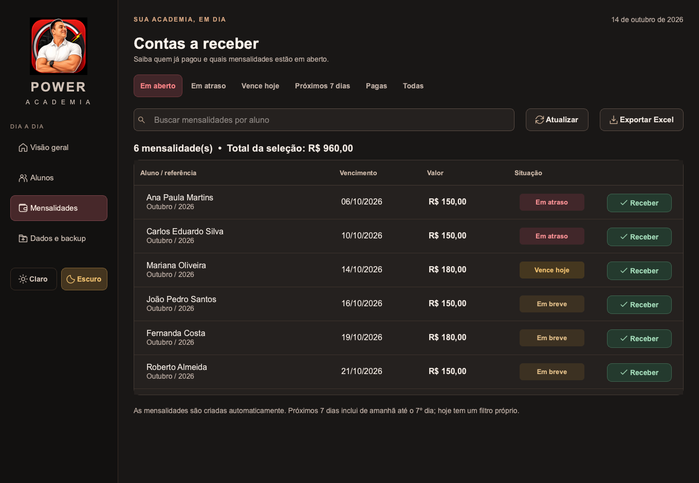

# Power Academia

Aplicativo desktop para cadastrar alunos e controlar mensalidades. Toda a interface está em português, com botões grandes e a identidade visual do Douglas Coach. Funciona sem internet e sem assinatura.

Este projeto é independente da consultoria online. O retrato foi **copiado** de `../static/img/consulting-logo.png`; os arquivos e o banco do sistema online permanecem intactos.





## O que já funciona

- Painel com alunos ativos, valores atrasados, vencimentos de hoje e dos próximos 7 dias e total recebido no mês.
- Cadastro, edição, busca por nome ou telefone, desativação e exclusão de alunos.
- Nome, endereço, telefone, data de entrada, dia de vencimento, mensalidade e observações.
- Mensalidades recorrentes, filtros por situação, recebimento com data e forma de pagamento e opção de desfazer um recebimento.
- Ficha com histórico de mensalidades de cada aluno.
- Exportação para CSV compatível com Excel, com acentos, separador `;` e valores com vírgula.
- Backup manual, recuperação pela interface e até 30 cópias diárias automáticas. Uma cópia adicional é guardada antes de excluir um aluno ou restaurar dados.
- Temas claro e escuro, com botões de sol e lua abaixo de Dados e backup. A escolha é lembrada ao reabrir.
- Prévia opcional com dados fictícios, separada dos cadastros reais e sem avisos sobrepostos à interface.

## Experimentar agora

No macOS, requer Python 3.12. No Windows, o código pode usar Python 3.10 de 32 bits ou Python 3.12 de 64 bits, com as dependências correspondentes. A instalação das dependências precisa de internet; o aplicativo em si funciona offline.

No macOS, abra `Abrir Academia.command` ou use o terminal, dentro desta pasta:

```bash
python3 -m venv .venv
.venv/bin/python -m pip install -r requirements.txt
.venv/bin/python main.py --demo
```

Sem `--demo`, o aplicativo abre o cadastro real, inicialmente vazio. No macOS, o comando `./"Abrir Academia.command" --demo` também abre a demonstração.

No Windows, com Python instalado, abra `Iniciar.bat`. Para experimentar com dados fictícios pelo terminal:

```bat
Iniciar.bat --demo
```

Depois de instalado pelo futuro instalador, Douglas precisará apenas do atalho **Power Academia**, sem Python ou terminal.

## Como Douglas usa

1. **Cadastrar aluno:** informe nome, valor da mensalidade, dia de vencimento e os outros dados desejados.
2. **Primeira mensalidade:** escolha o primeiro mês que deve ser cobrado. Ao migrar alunos antigos, escolha o mês atual para não gerar dívidas antigas. Se esse mês já estiver pago, registre o pagamento.
3. **Mensalidades:** filtre por **Em atraso**, **Vence hoje** ou **Próximos 7 dias**. O filtro de próximos dias inclui de amanhã ao sétimo dia, inclusive.
4. **Receber:** confirme o valor integral recebido, a data e a forma de pagamento. O histórico fica disponível na ficha e no filtro **Pagas**.
5. **Alunos → Ver ficha:** altere dados, desative ou exclua o aluno.
6. **Dados e backup → Salvar backup:** guarde uma cópia em um pendrive ou outro local.

O arquivo [LEIA-ME.txt](LEIA-ME.txt) contém o guia curto para o Douglas.

## Como as mensalidades se comportam

- As cobranças começam no mês definido no cadastro e são geradas até o mês atual. Se os próximos 7 dias cruzarem o mês, o próximo mês também é preparado.
- Um mesmo aluno só recebe uma mensalidade por mês. Cobranças vencidas continuam abertas até o recebimento.
- Dias 29, 30 e 31 usam o último dia em meses mais curtos, incluindo fevereiro de anos bissextos.
- O mês inicial é fixado no cadastro. Não há rateio, juros, pagamentos parciais ou integração com banco; **Receber** registra o pagamento informado pelo Douglas.
- Alterar valor ou dia atualiza apenas mensalidades em aberto que ainda não venceram. Se o novo dia já tiver passado, a cobrança que era futura vence hoje. Pagamentos e atrasos anteriores preservam os valores e datas originais.
- Desativar mantém pagamentos e dívidas anteriores, remove cobranças em aberto de hoje em diante e interrompe novas cobranças. Reativar retoma no próximo vencimento, sem cobrar o período inativo.
- Excluir pede confirmação e apaga cadastro e histórico. O aplicativo guarda antes uma cópia completa dos dados na pasta `backups`.
- O valor **Recebido neste mês** usa a data do recebimento, mesmo que a mensalidade seja de um mês anterior.

## Onde os dados ficam

Os dados são guardados em SQLite, um banco em **um arquivo local** chamado `academia.sqlite3`. As gravações usam transações; valores são armazenados em centavos inteiros. Excel serve para consultar as exportações, e não é necessário para usar o app.

| Sistema | Pasta padrão |
| --- | --- |
| Windows | `%LOCALAPPDATA%\DouglasAcademia` |
| macOS | `~/Library/Application Support/DouglasAcademia` |
| Linux | `~/.local/share/DouglasAcademia` |

O nome interno da pasta de dados foi preservado para continuar abrindo cadastros da primeira versão. O tema fica em `preferencias.ini` nessa mesma pasta, separado do banco.

O app mostra o caminho exato em **Dados e backup**. Dados ficam separados dos arquivos instalados e não são apagados ao desinstalar pelo instalador preparado neste projeto. O backup diário é atualizado após alterações e ao fechar; são mantidas as últimas 30 datas. Cópias manuais e anteriores a exclusões/restaurações não entram nessa limpeza.

Para desenvolvimento com dados separados:

```bash
.venv/bin/python main.py --data-dir ./dados
```

O modo `--demo` usa uma pasta temporária, ignora `--data-dir` e descarta as alterações ao sair. Apenas uma instância pode abrir a mesma pasta de dados por vez.

## Instaladores Windows de 32 e 64 bits

A aplicação usa o mesmo código, interface e banco nas duas arquiteturas:

| Pacote | Biblioteca | Python de compilação | Alvo |
| --- | --- | --- | --- |
| 32 bits (x86) | PySide2 / Qt 5.15.2.1 | Python 3.10 de 32 bits | Windows 10 de 32 ou 64 bits |
| 64 bits (x64) | PySide6 / Qt 6.8.3 | Python 3.12 de 64 bits | Windows 10 1809+ de 64 bits e Windows 11 |

O [PySide2 fornece binários oficiais win32](https://pypi.org/project/PySide2/5.15.2.1/). A versão de 64 bits segue os [requisitos do Qt 6.8](https://doc.qt.io/qt-6.8/supported-platforms.html). A camada `academia/qt.py` mantém uma API compartilhada para os dois pacotes.

O instalador universal detecta a arquitetura e a versão do Windows. Em um Windows 10 x64 compatível com Qt 6, instala a versão x64; em Windows de 32 bits ou Windows 10 mais antigo, usa a versão x86. A escolha é automática. Dados e backups ficam na mesma pasta nas duas versões.

Arquivos de saída previstos em `output/`:

- `Instalar-Power-Academia.exe`: instalador universal, recomendado.
- `Instalar-Power-Academia-32bits.exe`: versão x86.
- `Instalar-Power-Academia-64bits.exe`: versão x64.

Os executáveis precisam ser compilados no Windows, conforme a [documentação do PyInstaller](https://pyinstaller.org/en/stable/). Para gerar localmente:

1. Instale Python 3.10 x86 e Python 3.12 x64 do python.org.
2. Instale Inno Setup 6 com compilador de 32 bits e adicione `ISCC.exe` ao PATH.
3. Nesta pasta, execute no PowerShell:

```powershell
powershell -ExecutionPolicy Bypass -File .\build_windows.ps1
```

O script cria ambientes separados `.venv-x86` e `.venv-x64`, executa os testes em ambos, gera os executáveis em `dist/x86` e `dist/x64`, verifica cada executável e compila os três instaladores. Para gerar apenas uma arquitetura:

```powershell
.\build_windows.ps1 -Architecture x86
.\build_windows.ps1 -Architecture x64
```

O fluxo `.github/workflows/power-academia-windows.yml` faz esses passos em Windows Server 2022 e verifica os três instaladores. Depois da instalação, abre o executável com dados temporários e verifica telas, temas, cadastro, pagamento, exportação e restauração. Os arquivos são guardados como artefatos do Actions. A entrega adicional usa a branch `build/power-academia-installers` do mesmo repositório, com partes e hashes SHA-256 para conferir o download.

O parâmetro interno `--self-test caminho-do-relatorio.json` permite conferir um executável sem tocar nos dados reais. Ele sempre usa uma pasta temporária e encerra ao concluir. O pacote final dispensa Python, terminal e internet no computador do Douglas.

Ainda é necessário conferir a primeira instalação no computador de destino. A existência dos scripts não significa que os instaladores já foram gerados; os registros do build determinam o resultado.

## Testes e prévias

Dentro desta pasta, execute:

```bash
.venv/bin/python -m unittest discover -s tests -v
.venv/bin/python scripts/preview.py
```

No Windows, use `.venv\Scripts\python.exe` nos mesmos comandos. Os testes da interface usam Qt em modo `offscreen`. No ambiente restrito do macOS, o Qt pode precisar de execução fora do sandbox para detectar os recursos do processador.

Os testes cobrem: persistência, cobranças recorrentes, filtros, virada do ano, fevereiro e anos bissextos, edição preservando histórico, pagamentos, desativação, exclusão, exportação, backups fluxos reais de interface e persistência da escolha do tema.

As imagens em [docs/previas](docs/previas) foram capturadas da interface real usando dados fictícios. Não são imagens conceituais.

## Estrutura

```text
main.py                    Entrada, idioma, pasta de dados e instância única
academia/storage.py        SQLite e regras de cobrança
academia/ui.py             Interface desktop
academia/theme.py          Cores, fontes e ícones
academia/qt.py             Compatibilidade de Qt 5 e Qt 6
academia/diagnostics.py    Verificação do pacote instalado
academia/demo.py            Dados fictícios para experimentar
assets/                    Retrato do Douglas e ícone do Windows
tests/                     Testes de regras e interface
scripts/preview.py         Captura de telas reais
PowerAcademia.spec        Empacotamento PyInstaller
installer.iss              Instalador Inno Setup em português
build_windows.ps1          Testes, empacotamento e geração do instalador
```

A interface usa [Qt for Python / PySide6](https://doc.qt.io/qtforpython-6/). O aplicativo não depende do Django, de servidor, de navegador ou de serviços externos.
